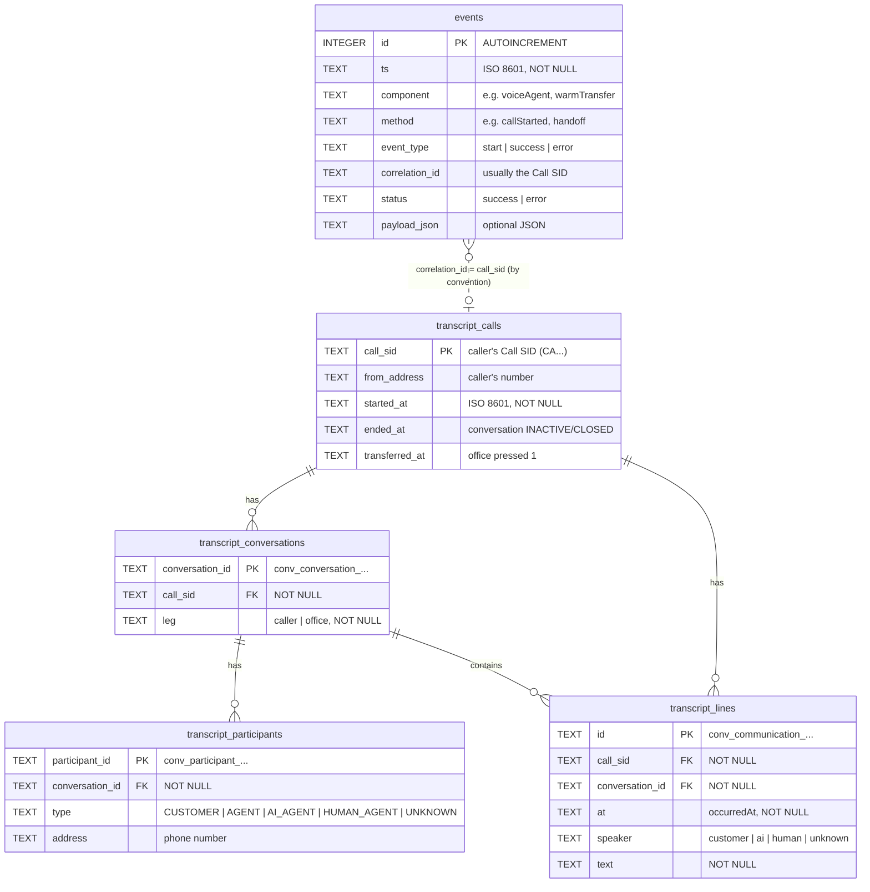

# Database schema

All app data lives in one SQLite file: `events.db` by default, or the path in
`EVENTS_DB_PATH`. It's gitignored. Two parts of the app write to it:

| Area | Tables | Written by | Read by |
| --- | --- | --- | --- |
| Events | `events` | `emitEvent()` in `src/observability.ts` | `GET /events` (wallboard events table) |
| Transcripts | `transcript_calls`, `transcript_conversations`, `transcript_participants`, `transcript_lines` | Conversation Orchestrator webhooks → `src/transcripts/store.ts` | `GET /calls`, `GET /calls/stream` (wallboard) |

> **PHI:** transcript text and phone numbers can be personal health information.
> Transcripts older than `TRANSCRIPT_RETENTION_DAYS` (default 7) are deleted at startup.
> The `events` table has no retention.

## Entity relationship diagram



The relationships are logical only. SQLite has no `FOREIGN KEY` constraints on these
tables; the store keeps them consistent.

## Tables

### `events`

Audit log of what the app's Twilio integrations do. One row per instrumented step.

| Column | Type | Null | Notes |
| --- | --- | --- | --- |
| `id` | INTEGER | no | Primary key, autoincrement |
| `ts` | TEXT | no | ISO 8601 timestamp |
| `component` | TEXT | yes | Module that emitted it, e.g. `voiceAgent`, `warmTransfer`, `transcripts` |
| `method` | TEXT | yes | Step, e.g. `callStarted`, `handoff`, `beginTransfer`, `recoverCaller` |
| `event_type` | TEXT | yes | `start`, `success` or `error` |
| `correlation_id` | TEXT | yes | Ties one interaction's events together; usually the Call SID |
| `status` | TEXT | yes | `success` or `error` |
| `payload_json` | TEXT | yes | Optional JSON details |

### `transcript_calls`

One row per call, keyed by the **caller's** Call SID.

| Column | Type | Null | Notes |
| --- | --- | --- | --- |
| `call_sid` | TEXT | no | Primary key (`CA…`) |
| `from_address` | TEXT | yes | Caller's number, taken from the `CUSTOMER` participant |
| `started_at` | TEXT | no | First communication seen |
| `ended_at` | TEXT | yes | Set when the caller's conversation goes `INACTIVE` or `CLOSED` |
| `transferred_at` | TEXT | yes | Set when the office presses 1 on a warm transfer |

### `transcript_conversations`

Maps each Orchestrator conversation to the call it belongs to.

| Column | Type | Null | Notes |
| --- | --- | --- | --- |
| `conversation_id` | TEXT | no | Primary key (`conv_conversation_…`) |
| `call_sid` | TEXT | no | → `transcript_calls.call_sid` |
| `leg` | TEXT | no | `caller`, or `office` for a separate warm-transfer leg conversation |

With ConversationRelay ingestion the human portion of a transfer is transcribed into the
caller's own conversation, so `office` rows only appear if the office's call gets its own
conversation.

### `transcript_participants`

Participants reported by Orchestrator, used to label each line's speaker.

| Column | Type | Null | Notes |
| --- | --- | --- | --- |
| `participant_id` | TEXT | no | Primary key (`conv_participant_…`) |
| `conversation_id` | TEXT | no | → `transcript_conversations.conversation_id` |
| `type` | TEXT | yes | `CUSTOMER`, `AGENT`, `AI_AGENT`, `HUMAN_AGENT` or `UNKNOWN` |
| `address` | TEXT | yes | Voice address (phone number) |

### `transcript_lines`

One row per transcribed utterance.

| Column | Type | Null | Notes |
| --- | --- | --- | --- |
| `id` | TEXT | no | Primary key (`conv_communication_…`); webhook retries are ignored |
| `call_sid` | TEXT | no | → `transcript_calls.call_sid` |
| `conversation_id` | TEXT | no | → `transcript_conversations.conversation_id` |
| `at` | TEXT | no | When it was said (`occurredAt`) |
| `speaker` | TEXT | no | `customer`, `ai`, `human` or `unknown` |
| `text` | TEXT | no | The utterance |

**Index:** `transcript_lines_call (call_sid, at)` loads one call's transcript in order.

## Speaker mapping

`speaker` is decided when the line arrives and isn't recomputed later:

| Participant `type` | Before transfer | After `transferred_at` |
| --- | --- | --- |
| `CUSTOMER` | `customer` | `customer` |
| `AI_AGENT` | `ai` | `ai` |
| `HUMAN_AGENT` | `human` | `human` |
| `AGENT` (our number's side) | `ai` | `human` (the office) |
| unknown / missing | by address: our number → agent side, otherwise `customer` | same, agent side → `human` |

## Handy queries

```sql
-- Latest calls with line counts
SELECT c.call_sid, c.from_address, c.started_at, c.transferred_at, COUNT(l.id) AS lines
FROM transcript_calls c LEFT JOIN transcript_lines l ON l.call_sid = c.call_sid
GROUP BY c.call_sid ORDER BY c.started_at DESC LIMIT 10;

-- One call's transcript
SELECT at, speaker, text FROM transcript_lines
WHERE call_sid = 'CA...' ORDER BY at;

-- Errors in the events log
SELECT ts, component, method, correlation_id FROM events
WHERE status = 'error' ORDER BY id DESC LIMIT 20;
```
