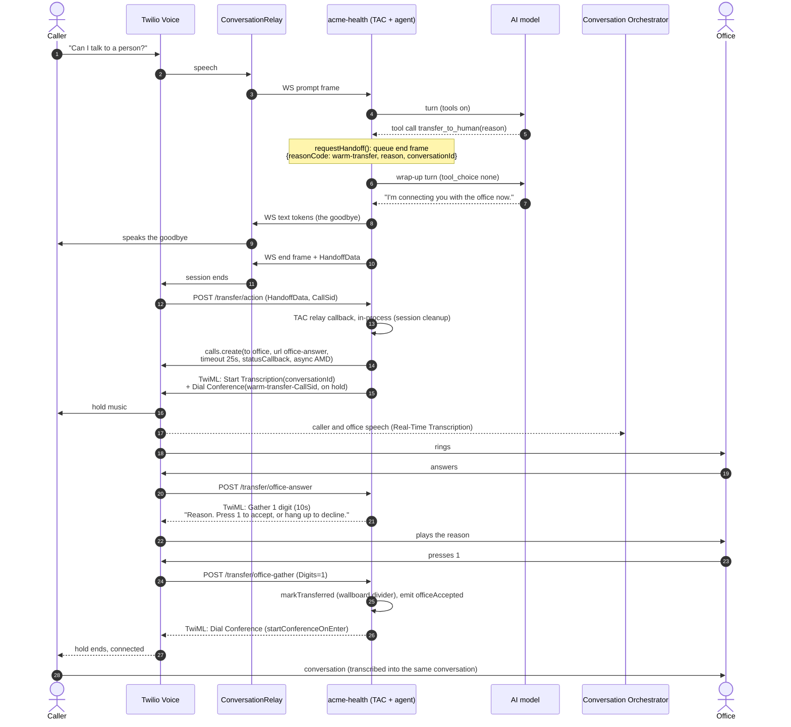
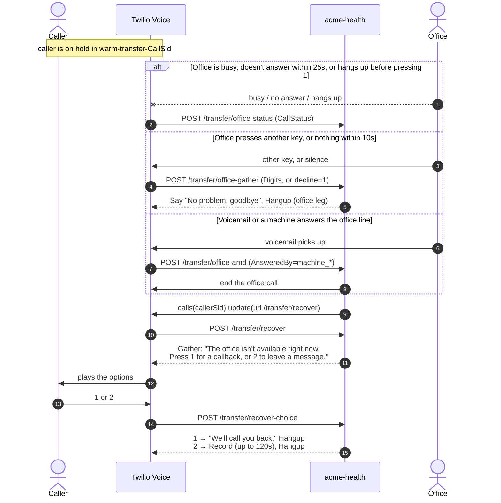

# Warm handoff: AI agent → office

When a caller asks for a person, or needs something the AI agent can't help with, the call
is handed to someone at the office **without dropping the caller and without a cold
transfer**. The caller waits on hold while the office is dialed, the office hears why the
caller is calling and accepts with a keypress, and only then are the two connected. If
the office can't take the call, the caller is brought back from hold with an apology.

Code: [`src/tools/warmTransfer.ts`](../src/tools/warmTransfer.ts) (tool + routes),
[`src/handlers/voiceAgent.ts`](../src/handlers/voiceAgent.ts) (`sendPendingHandoff`),
[`src/tac/callContext.ts`](../src/tac/callContext.ts) (`requestHandoff`),
[`src/llm/agent.ts`](../src/llm/agent.ts) (goodbye with tools off).

## In short

1. The AI decides to hand off and calls the `transfer_to_human` tool with a one-line reason.
2. The tool only **queues** the handoff. The AI gets one last reply, with tools disabled,
   to say "I'm connecting you now".
3. After that goodbye has been spoken, the app ends the ConversationRelay session with an
   `end` frame carrying `HandoffData`.
4. Twilio calls the relay's `<Connect action>` URL, `POST /transfer/action`. The app puts
   the caller in a private conference **on hold**, starts transcribing the human portion,
   and dials the office.
5. The office answers and hears the reason: *"Caller has a billing question. Press 1 to
   accept the call, or hang up to decline."*
6. On **1**, the office joins the conference, hold music stops and the two are connected.
   Anything else brings the caller back from hold.

## Sequence: the successful path

## Sequence: when the office can't take the call

Every way the transfer can fail ends in the same place: `recoverCaller()` redirects the
**caller's own call** out of hold to `/transfer/recover`. It runs at most once per transfer
and never after a bridge.

One more case skips the hold entirely: if the office call can't be placed at all
(`calls.create` throws inside `/transfer/action`), the caller is never parked, and
`/transfer/action` answers with a TwiML redirect straight to `/transfer/recover`.

## Routes

All routes check the `X-Twilio-Signature`. The conference is named
`warm-transfer-<caller CallSid>`, and per-transfer state lives in memory, keyed by that name.

| Route | Called by | What it does |
| --- | --- | --- |
| `POST /transfer/action` | ConversationRelay `<Connect action>` when the relay session ends | Forwards the payload to TAC's relay callback for cleanup. On a `warm-transfer` handoff, dials the office and returns TwiML that starts transcription and parks the caller on hold. Any other session end returns `<Hangup>`. |
| `POST /transfer/office-answer` | The office answering the outbound call | Plays the reason and gathers one digit (10 s). No input redirects to a decline. |
| `POST /transfer/office-gather` | The office's keypress, or the no-input redirect | **1** bridges the office into the conference. Anything else recovers the caller and hangs up the office leg. |
| `POST /transfer/office-status` | Status callback when the office call ends | Recovers the caller if they were never bridged (busy, no-answer, failed, canceled, hung up early). Ignored after a bridge. |
| `POST /transfer/office-amd` | Async answering-machine detection | On `machine_*` or `fax`, recovers the caller and ends the office call. |
| `POST /transfer/recover` | `recoverCaller()` redirecting the caller | Apologises and offers a callback (1) or a message (2). |
| `POST /transfer/recover-choice` | The caller's keypress | Acknowledges a callback request, or records a message (up to 120 s). **Stub:** neither is sent anywhere yet. |

## Design details

**The goodbye is spoken before the session ends.** `transfer_to_human` doesn't end the call
itself. It stores the `end` frame on the TAC session (`requestHandoff`), and the agent's
next model call runs with `tool_choice: none`, so it can only speak a short "connecting you
now". `sendPendingHandoff` sends the `end` frame only after that reply has finished
streaming. TAC sends this frame itself only from its non-streaming path, which this app
doesn't use.

**No cold transfer.** The caller is parked with `startConferenceOnEnter: false`, so they hear
hold music in an empty room. The office joins with `startConferenceOnEnter: true` only after
pressing 1. The office always hears the reason first, and a declined transfer never leaves
the caller connected to nobody.

**Recovery redirects the caller, not the conference.** A conference that hasn't started can't
be reliably listed through the Participants API, so recovery uses the caller's own Call SID
(stored with the transfer) to redirect their leg straight to `/transfer/recover`.

**The reason is safe to speak.** The model writes it, and the tool's schema asks for "one
short line … no dates of birth or other identifiers". It is played to the office and logged
in the `beginTransfer` and `handoff` events.

**One transcript across AI and human.** In orchestrated mode, the handoff carries the
Orchestrator `conversationId`. `/transfer/action` starts `<Transcription conversationId=…>` on
the caller's leg before the conference, so the human portion lands in the **same**
conversation as the AI portion. ConversationRelay's speech-to-text stops when its session
ends, so only one engine runs at any moment. The voice channel's timeouts (`inactive: 5`,
`closed: 15` minutes) keep that conversation open across the handoff. The wallboard shows
office lines below a "Transferred to office" divider.

**Studio instead of a phone transfer.** With `TWILIO_STUDIO_HANDOFF_FLOW_SID` set (orchestrated
mode only), `transfer_to_human` uses TAC's `createStudioHandoffTool` and TAC points the
`<Connect action>` at the Studio flow (for example Flex). None of the routes above are used.

## Configuration

| Setting | Effect |
| --- | --- |
| `OFFICE_PHONE_NUMBER` | E.164 number the office leg dials. If unset, the tool tells the agent transfers aren't set up, and the agent offers to take a message instead. |
| `TWILIO_PHONE_NUMBER` | Caller ID for the office leg. |
| `PUBLIC_HOST` | Builds every callback URL. Must match the host Twilio calls, or signature checks fail. |
| `TWILIO_STUDIO_HANDOFF_FLOW_SID` | Switches to the Studio handoff (orchestrated mode only). |
| `acme-health-voice` VOICE timeouts | `inactive: 5, closed: 15` so the human portion joins the AI portion's conversation. |

## Events

Each step is logged to the events table (see [schema](schema.md)), keyed by the caller's
Call SID, and shown on the call's timeline on the wallboard.

| Event | When | Payload |
| --- | --- | --- |
| `agent.toolCall` | The AI calls `transfer_to_human` | `tool`, `ok`, `outcome.transferred` |
| `voiceAgent.handoff` | The `end` frame is sent | `target`, `reasonCode`, `reason` |
| `voiceAgent.callEnded` | The ConversationRelay session closes | `durationSec` (AI portion), `turns`, `verified`, `handedOff` |
| `warmTransfer.beginTransfer` | The office leg is placed (or fails) | `officeCallSid`, `reason`, `transcribingHumanLeg`, or `error` |
| `warmTransfer.officeAccepted` | The office presses 1 | — |
| `warmTransfer.recoverCaller` | The caller is brought back from hold | `why` (for example `office call no-answer`), or `error` |

## Limits

- **Single instance.** Pending transfers live in memory (`PENDING`). With more than one app
  instance, the office callbacks could reach an instance that doesn't know the transfer.
  Use a shared store such as Redis.
- **Callback and voicemail are stubs.** `/transfer/recover-choice` acknowledges a callback
  and records a message, but neither is sent to a queue or inbox yet. Recordings may
  contain PHI, so keep them on a HIPAA-eligible account under a BAA.
- **No retry or second office number.** If the office doesn't answer within 25 seconds, the
  caller is recovered straight away.
